# 01 总体架构与术语

所属基线：[v1.1](./README.md)。本文规定职责边界和当前部署方向，实际进程拆分与资源数量另做详细设计。

## ARC-01 业务目标与接入

用户输入明确金额参与竞拍，接口及时返回自己的裁决结果，通过排行榜查看是否领先，并接收截止时间和个人报价状态更新。系统支持多个场次同时开拍；单场尾盘并发需要正确裁决，而不是依靠拆散同场状态获得表面上的并行。

当前入口使用开源 NGINX，负责 HTTPS 接入、反向代理、请求分发及基础入口限流。业务鉴权、资格、报价和积压限流的规则由后端负责。当前不额外增加自研网关层。

- HTTP 请求可以进入任意业务实例，不要求同一场次固定到某个应用实例。
- Redis 客户端根据场次 Key 定位槽位；NGINX 不负责 Redis 路由。
- WebSocket 连接建立后由对应后端承载，同场用户可以分布在不同推送实例。
- 跨实例房间广播与个人投递由后端实现，NGINX 仅代理连接。
- 出价结果未知时不依靠网关自动重提出价；特别是不启用“请求已发送后仍强制重试非幂等出价”的策略。
- HTTP 轮询、WebSocket least_conn 属于可用配置建议，具体上游组、心跳、超时、限流参数和健康检查配置不在本基线冻结。
- 单台 NGINX 是初期可行部署，不代表入口高可用。入口冗余方案和容量需要后续确定。

## ARC-02 逻辑架构

```mermaid
flowchart TD
    U[用户] --> N[NGINX 接入与负载均衡]
    N --> B[多实例业务服务]
    N --> W[多实例 WebSocket 服务]
    B --> R[Redis Cluster：单场同槽 Lua 裁决]
    R --> Q[pending → inflight → 报价转发器]
    Q --> K[Kafka 报价 Topic]
    K --> P[报价落库消费组]
    K --> C[个人确认消费组]
    P --> D[数据库：权威持久化与资金事务]
    C --> UC[按 user_id 组织的个人缓存]
    UC --> W
    R -. 场次变化通知；分发机制待细化 .-> W
    R --> T[截止同步与关场调度]
    T --> D
    B --> F[用户钱包冻结、解冻、结算与平台收入记账]
    F --> D
    D --> O[资金 Outbox → Kafka → 资金消费者]
    O --> D
    D --> S[已提交变更同步：CDC 或 Outbox 待选]
    S --> E[独立 Elasticsearch 服务]
    B --> L[拍品列表查询]
    L --> E
```

图中箭头表示数据流或调用关系，不表示每个框必须是独立微服务。Redis 的通知箭头由应用或通知机制承接，不表示 Redis Lua 能直接调用 WebSocket、数据库或 Kafka。

## ARC-03 组件职责与数据权威

| 组件 | 负责 | 不负责 |
| --- | --- | --- |
| 业务服务 | 身份、请求、缓存回查、Lua 调用、即时回执、后续任务触发 | 不在本机保存唯一场次状态 |
| Redis | 实时裁决、场次运行截止、Top10、资格缓存、待发事件 | 不替代资金数据库事务 |
| Kafka | 报价与任务异步分发、消费与重放 | ACK 不代表数据库事务成功 |
| 数据库 | 拍品、场次、报名、有效报价、结果、订单、账户、流水、Outbox | 不要求每次有效报价在返回前都同步落库 |
| ES | 用户列表的关键词、条件、排序和分页 | 不裁决能否出价、是否中拍或是否付款 |
| WebSocket 服务 | 场次广播、个人状态推送、断线恢复配合 | 通知不取代可查询的业务状态 |

数据库是权威持久化存储；Redis 是当前运行中的出价裁决点。两者通过异步链路衔接，因此数据库可能尚未拥有刚被 Redis 接受的报价。恢复时不能简单用滞后数据库覆盖新运行状态；故障恢复与正式结果证据核对方式仍需详细设计。

ES 仅由数据库已提交的变化派生，允许延迟，可重建。实时出价响应与广播不等待 ES。订单、流水及资金处理只以数据库事务结果为准。

## ARC-04 场次、拍品和路由

| 术语／标识 | 含义与边界 |
| --- | --- |
| lot_id | 拍品身份；可经历多次拍卖 |
| round_id | 一次拍卖场次的唯一主键；旧稿的拍品轮次／auction_epoch 在本基线统一称场次 |
| user_id | 登录用户身份；竞拍者、买家、卖家是不同业务角色 |
| bid_id | 一笔报价的身份；由后端生成，投递及补发沿用原值 |
| order_id | 正式结果产生的中拍订单；同场最多一个中拍订单 |
| flow_id | 钱包资金变化或平台收入记录的雪花流水号 |
| 状态版本 | 用于当前报价状态更新及展示防回退，不等同于 Kafka offset |
| 截止版本 | 用于加时截止同步和防止旧截止覆盖新截止 |

一场的运行 Key 使用相同哈希标签。不同场次可以落在不同槽；不同槽也可能位于同一 Redis 主节点。单场同槽不意味着每场独占一台 Redis，也不意味着每场只用一条客户端连接。槽位迁移或切主由客户端与集群机制处理，业务不绑定某个固定物理 Redis 地址。

bid_id 不再决定同一场进入不同 Redis 分片。Kafka 消息键另行定义，当前保留 bid_id 方案，不能从 Redis 路由直接推导 Kafka 路由。

重拍新建 round_id，重新区分报名资格、报价、结果和订单；旧任务不得误改新场对应的拍品状态。

## ARC-05 状态分层

| 对象 | 已确定语义 |
| --- | --- |
| 拍品 | 待拍卖；待成交（覆盖竞价与等待付款）；已出售 |
| 场次 | 正常状态 WAITING → RUNNING → CLOSED；异常及人工暂停另行设计，无场次级冻结状态 |
| 订单 | 待支付、已支付、超时关闭等；是否可付款还要检查截止时间 |
| 报名押金 | 保存实际冻结金额；FROZEN 转 RELEASED／APPLIED／FORFEITED，后三者互斥 |
| 报价回执 | 已接收、Kafka 已确认、待核对；数据库是否已保存是另一个事实 |

用户账户仅保存可用与冻结余额，不维护平台余额或场次平台子账户；平台收入写订单和流水，资金流程见 05／06。场次 CLOSED 不代表其全部押金已处理完成。

拍品开拍设待成交；正常付款及结算完成设已出售；正尾款超时流拍完成处理后恢复待拍卖。不能仅凭“拍品待成交”判断仍可出价。

## ARC-06 性能与一致性取舍

单场 Lua 裁决保持短小，不等待外部 I/O。通过多实例接入与不同场次分散扩展整体能力。容量分别验证入口、热点场次、同时开拍数、报价发送 ACK 等待、数据库写入、WebSocket 广播和 ES 查询。

当前没有目标吞吐数字。AOF everysec 与快速返回是主动选择，不能据此宣称零数据丢失或已实现高可用。资金事务与幂等属于明确约束，不随“竞价侧优先持续服务”的取舍一起放宽。
