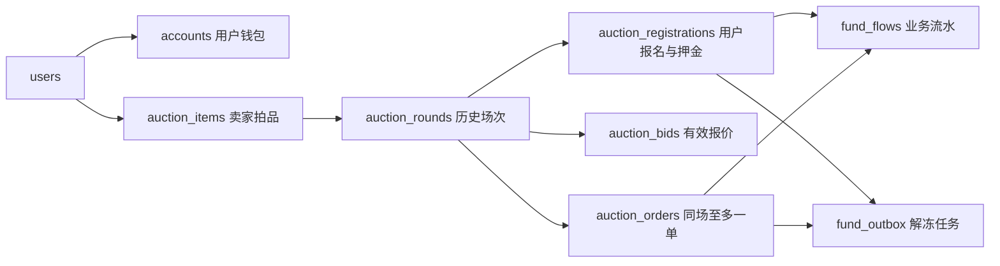

# 当前已确定的数据库表设计

日期：2026-11-17。来源：[confirm-design v1.1](../confirm-design/README.md) 与 [数据库逻辑设计](../confirm-design/10-数据库逻辑设计.md)。本目录按表拆分已确认内容，供后续 DDL 与开发参考；业务规则继续以 confirm-design 及后续明确决定为准，两处调整需同步。

## 表目录

| 表 | 职责 |
| --- | --- |
| [users](./01-users.md) | 用户表 |
| [accounts](./02-accounts.md) | 用户钱包表 |
| [auction_items](./03-auction_items.md) | 拍品表 |
| [auction_rounds](./04-auction_rounds.md) | 拍卖场次表 |
| [auction_registrations](./05-auction_registrations.md) | 报名与押金表 |
| [auction_bids](./06-auction_bids.md) | 有效出价记录表 |
| [auction_orders](./07-auction_orders.md) | 中拍订单表 |
| [fund_flows](./08-fund_flows.md) | 资金流水表 |
| [fund_outbox](./09-fund_outbox.md) | 资金任务表 |

## 共同约定

- 仅覆盖九张核心表，用户钱包保存可用余额和冻结金额，不维护平台余额或场次平台子账户。
- 金额用整数分，费率用基点；1000 = 10%，5000 = 50%。
- 押金状态归报名表，场次状态不承担冻结状态。
- 已确定的主键和业务唯一约束直接列出；“索引方向”仍需结合实际查询校验。
- 关联关系是逻辑关联，不代表已经选择数据库物理外键。
- flow_id 使用雪花 ID；其他 ID 的生成方式不在本次整理中新增决定。
- 当前是逻辑字段设计，不是可直接执行的建表 SQL。数据库产品、SQL 类型、长度、时间精度、默认值及未明确的可空规则待后续统一。

## 核心关系

图表示主要业务关联，不是物理外键图；充值流水另关联充值业务编号。

## 跨表事务依据

| 动作 | 同事务的核心变化 |
| --- | --- |
| 报名 | 钱包可用转冻结、报名 FROZEN、冻结流水 |
| 未中拍解冻 | 钱包冻结转可用、报名 RELEASED、解冻流水、任务 SUCCESS |
| 正常成交 | 买家冻结与尾款扣除、卖家入账、三类结算流水、报名 APPLIED、订单及拍品状态 |
| 正尾款超时 | 买家冻结扣除、卖家补偿、三类补偿流水、报名 FORFEITED、订单及拍品状态、任务 SUCCESS |
| 零尾款兜底 | 正常成交的全部资金效果及状态、对应任务 SUCCESS |

完整校验顺序及重复、冲突分支见 [资金设计](../confirm-design/05-账户与有向流水.md) 与 [订单和 Outbox 事务](../confirm-design/06-订单结算与资金Outbox.md)。Redis、Kafka、ES 与推送不属于数据库事务的原子提交范围。

## 尚未确定的字段表达

1. accounts 的用户关联是否由 owner_type／owner_id 简化为 user_id。
2. fund_flows 的用户／平台主体、交易对手、可用与冻结变化的物理列及可空约束。
3. fund_outbox 的多流水编号集合、零尾款兜底编号绑定、领取租约字段及完整枚举。
4. 其余表的物理类型、外键及未确认索引。

以上均在相关表内明确标注，不把建议字段当成已经确认的 SQL 规格。
